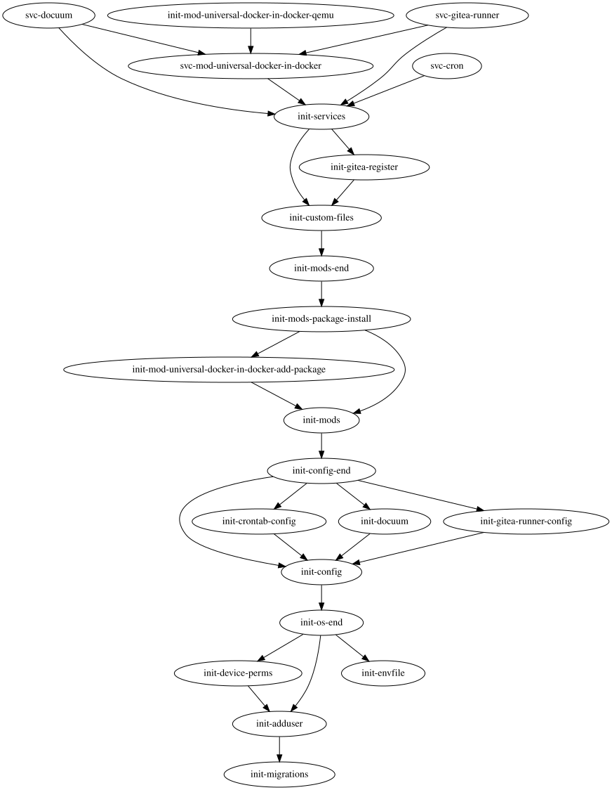
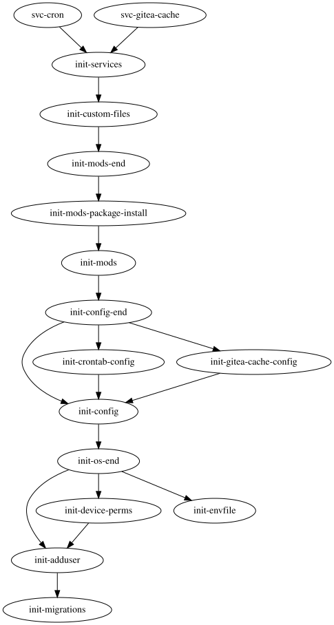

[](https://hub.docker.com/r/userid0x0/gitea-runner-docuum-dind/)
[](https://github.com/userid0x0/act_runner-docuum-dind/actions)
[](https://github.com/userid0x0/act_runner-docuum-dind)

# Gitea gitea-runner with docuum - Docker-in-Docker (DinD) variant

## Intention
A [gitea-runner](https://gitea.com/gitea/runner) Image based on [linuxserver.io](https://linuxserver.io)'s `baseimage-alpine`.

Included components:

* `docker` as Docker-in-Docker (DinD)<br> installed via a local `DOCKER_MOD`
* `gitea-runner` (formerly known as `act_runner`)<br> see also https://gitea.com/gitea/runner
* `docuum`

Persistent files are stored in `/config` & `/data` reducing the number of bind-mounts. Services are run as user `abc`.

The image cleans up unused images using the following strategy:

* crontab based pruning of dangling images (images with a `none` tag) - every 4h<br>command: `docker image prune --filter "dangling=true"`
* `docuum` for LRU based Docker Image cleanup<br>see also https://github.com/stepchowfun/docuum/tree/v0.27.3

A secondary image is generated to run a dedicated gitea-runner cache server.

## Images
* `docker.io/userid0x0/gitea-runner-docuum-dind:<tag>`<br>Tags:
  - `v<x>.<y>.<z>-<version>` with *x*/*y*/*z* aligned with the gitea-runner release / *version* signals changes in this repo
  - `master` build from the *master* branch in this repo aka development head
  - `nightly` build from the *master* branch in this repo usign gitea-runner nightly builds
* `docker.io/userid0x0/gitea-runner-cache:<tag>`<br>Tags:
  - `v<x>.<y>.<z>-<version>` with *x*/*y*/*z* aligned with the gitea-runner release / *version* signals changes in this repo
  - `master` build from the *master* branch in this repo aka development head
  - `nightly` build from the *master* branch in this repo usign gitea-runner nightly builds
* **Deprecated**: `docker.io/userid0x0/act_runner-docuum-dind`

## Usage - runner

### `docker-compose.yml`
```yaml
services:
  runner:
    image: docker.io/userid0x0/gitea-runner-docuum-dind:v5.4.1-1
    restart: unless-stopped
    privileged: true
    environment:
      PUID: <uid to use>
      PGID: <gid to use>
      # DOCUUM_ARGS: "--threshold 80GB"
    env_file:
      - .env
    volumes:
      - ./config:/config
      - docker:/data

volumes:
  docker:
```

### `.env`
```
GITEA_INSTANCE_URL: https://<...>
GITEA_RUNNER_REGISTRATION_TOKEN: <token>
GITEA_RUNNER_NAME: <name>
```

## Usage - external cache server

### `docker-compose.yml`
```yaml
services:
  runner:
    image: docker.io/userid0x0/gitea-runner-cache:v5.4.1-1
    restart: unless-stopped
    environment:
      PUID: <uid to use>
      PGID: <gid to use>
    volumes:
      - ./config:/config
      - cache:/data
    # networks:
    #   - <tbd.network>
    # labels:
    #   - "traefik.enable=true"
    #   - "traefik.http.routers.rGiteaActionsCacheHttp.rule=Host(`<tbd.url>`)"
    #   - "traefik.http.routers.rGiteaActionsCacheHttp.entrypoints=<tbd.http entrypoint>"
    #   - "traefik.http.routers.rGiteaActionsCache.rule=Host(`<tbd.url>`)"
    #   - "traefik.http.routers.rGiteaActionsCache.entrypoints=<tbd.https entrypoint>"
    #   - "traefik.http.routers.rGiteaActionsCache.tls=true"
    #   - "traefik.http.routers.rGiteaActionsCache.tls.certresolver=<tbd.resolver>"

volumes:
  cache:

# networks:
#   <tbd.network>:
#     external: true
```

## Multi-Instance mode
It's possible to run multiple instances of `gitea-runner` within that container. Please do not mix it up with the `runner.capacity` feature of `gitea-runner`. The usecase is that the runners will be connected to different organizations/repositories but share the docker image storage to reduce disk usage.

Known Limitations:
* `runner.tool_cache_mode: shared` is only supported for one runner<br>According to the gitea-team [1](https://gitea.com/gitea/runner/issues/1391) it's possible to do the tool cache manually using volume mounts
* Registration phase must register one new runner at a time (to be investigated) - seems to be related to the registration token validity

Implementation:
* the variables `GITEA_RUNNER_REGISTRATION_TOKEN`/`GITEA_RUNNER_NAME` can have a postfix `_<0..x>` (starting from 0)
* postfix `_0` can be omited
* variable `GITEA_RUNNER_REGISTRATION_TOKEN_<x>` is used to signals the number of instances
* the postfixes must be ascending starting from `0`
* The configuration file of the first instance resides as `/config/config.yaml` while for the secondary instances the files are placed into `/config/instance_<x>/config.yaml`
* In case no configuration file exists a template is generated using `gitea generate-config` with the following adaptions
  - the `runner.file` setting points to `/config/.runner` / `/config/instance_<x>/.runner`
  - the `host.workdir_parent` setting points to `/act/instance_<x>`

### `.env`
```
GITEA_INSTANCE_URL: https://<...>
GITEA_RUNNER_REGISTRATION_TOKEN_0: <first token>
GITEA_RUNNER_NAME_0: <name of first instance>
GITEA_RUNNER_REGISTRATION_TOKEN_1: <second token>
GITEA_RUNNER_NAME_1: <name of second instance>
```


## Adaptions/Modifications
### Environment Variables

* `PUID`/`PGID` - UID to use for services e.g. act_runner/docuum<br>This the is UID/GID of the files in `/config`<br> default: `911`
* `DOCUUM_ARGS` - command line arguments passed to docuum e.g. Image storage threshold, persistent images, ...<br>default `--threshold 80GB`

### `/custom-cont-init.d`
Based on https://docs.linuxserver.io/general/container-customization/#custom-scripts the image can be adapted to local requirements. Usage e.g.

* custom root certificate installation
* configuration changes e.g. `/etc/docker/daemon.json`

## Internals
### s6rc.d dependency graph - runner


### s6rc.d dependency graph - external cache server



